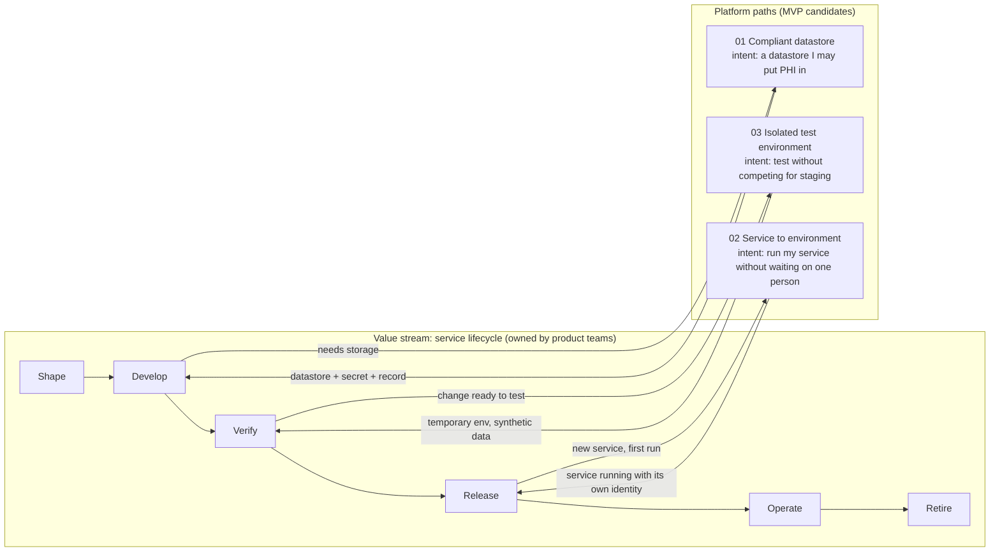

# Value stream: service lifecycle

> A living map, in the semantics of the paths-to-outcome model from *Thinking in Platforms*. Updated after every discovery round and every path built. Evidence: [discovery round 1](../discovery/synthesis.md) and [control functions](../discovery/control-functions.md) (all simulated).

## The value stream

| | |
|---|---|
| **Whose work** | Meridian's product teams (backend developers first; increasingly also AI coding agents acting for them) |
| **Intent** | Turn a product need into a change that runs reliably for patients and clinicians |
| **Outcome** | Features patients and care teams use, delivered safely with their health data protected |
| **Owned by** | The product teams. The platform does **not** own this stream; it intervenes in it |

### From the users' words to the value stream

Interviewees described their work as: *shape the work → set up → build and test → ship → run*.

The model keeps only the steps that **create value** in the stream itself. "Set up" was a real step in how people described their week, but nothing in it creates value for a patient: it is waiting for databases, reviews and hand-offs. It is the place where paths should intervene, not a step of the stream. With paths in place, "set up" should shrink until it disappears.

**Value stream steps:**

1. **Shape**: refine the need and design the change
2. **Develop**: write the code
3. **Verify**: test the change end to end
4. **Release**: get the change running in production
5. **Operate**: run, observe and fix
6. **Retire**: sunset the service (not yet explored in discovery)

## The map

Paths drop out of the value stream at recurring moments and return an output that lets the work continue.

## Paths placed on the stream

| Step | Recurring moment (trigger) | Path | Output back to the stream | Status |
|---|---|---|---|---|
| Develop | The service needs storage that doesn't exist yet | [01 Compliant datastore](../paths/01-compliant-datastore.md) | Reachable, encrypted, classified datastore; credentials as a secret; a record of the request | Building first |
| Verify | A change is ready to test end to end | [03 Isolated test environment](../paths/03-isolated-test-environment.md) | Temporary environment with synthetic data, cleaned up automatically | Queued |
| Release | A new service runs for the first time | [02 Service to environment](../paths/02-service-to-environment.md) | Service running, with its own identity, secrets and health checks | Discovering |

Interfaces and capabilities are **not designed yet**. That happens per path during the MVP, with the user.

## Control functions along the stream

| Who | Where they act today | Becomes, in the model |
|---|---|---|
| Security & Compliance | Data Protection Review before Develop can continue | Rules inside path 01 (later: a policy layer) |
| Cloud Ops | Ticket queue before Develop can continue | Implementation behind path 01's capability |
| Tomás (SRE) | Hand-off before Release | Runtime prerequisites encoded in path 02 |

## Gaps: friction seen but not covered by a path

The map shows what the MVP leaves untouched, so nothing is forgotten and nothing is silently promised.

| Step | Friction (intent) | Seen in | Decision |
|---|---|---|---|
| Develop / Verify | Get my service building and tested automatically (CI copied per repo) | 01, 04 | Revisit in path 02's deep dive: part of it or a path of its own |
| Develop | Change my service's database safely (schema migrations) | 05 | Watch for recurrence |
| Develop | Get a working development setup | 05 | Watch for recurrence |
| Operate | Rotate a credential safely; know what depends on it | 01, 03 | Candidate for after the MVP |
| Verify | Test against partner pharmacy sandboxes | 03 | Out of scope: outside Meridian's control |
| Retire | Not explored | none | Explore in a later discovery round |
